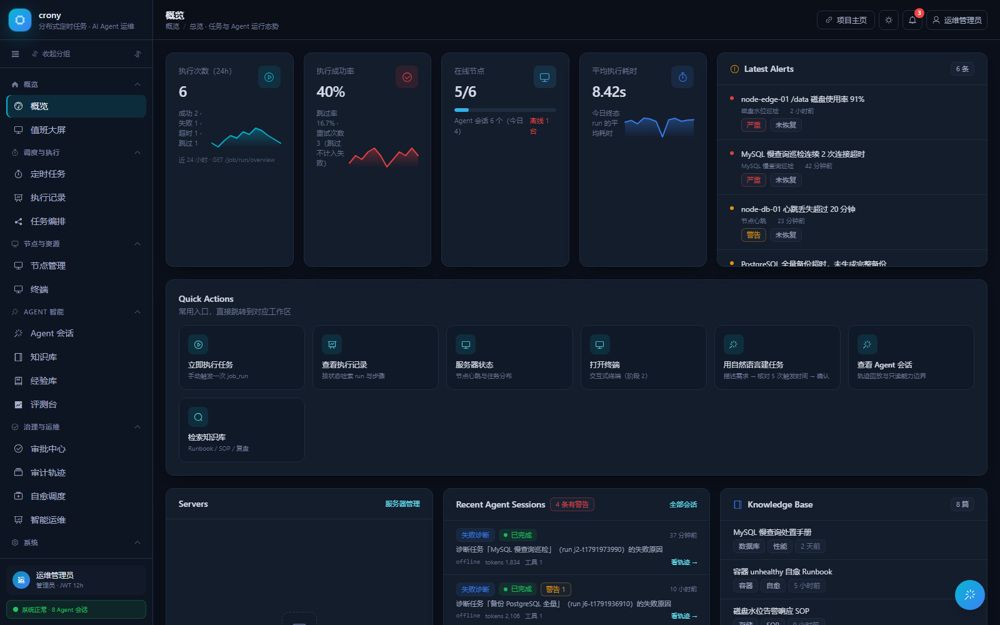
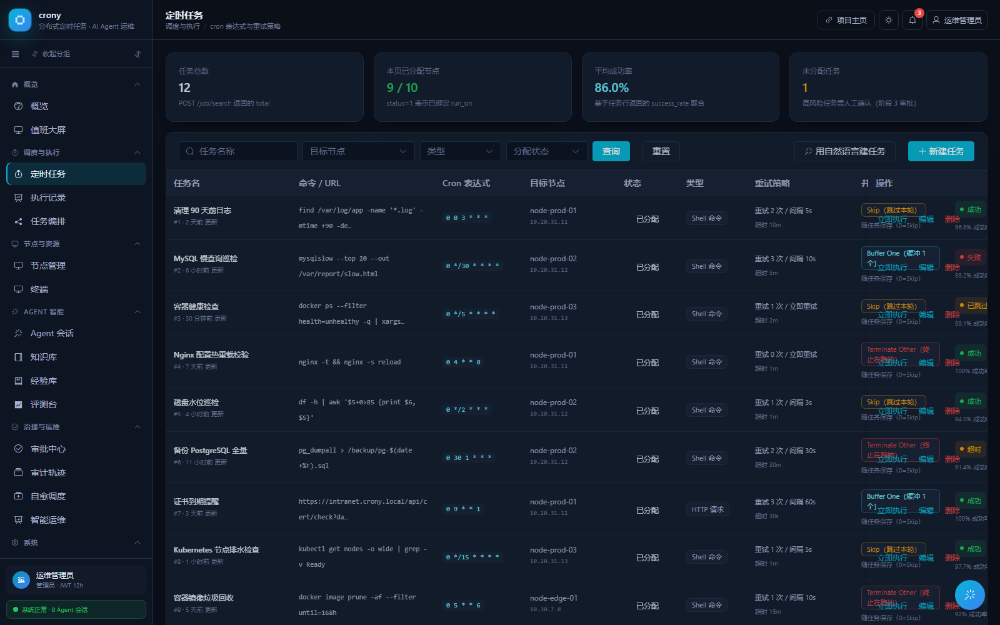
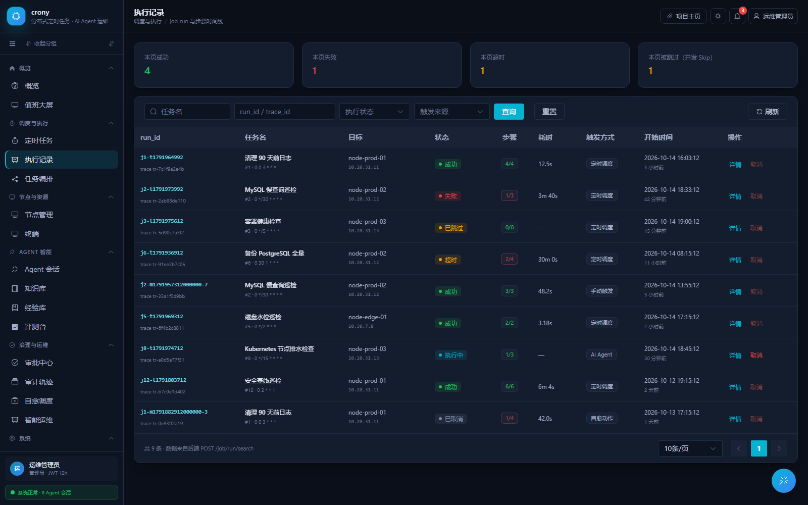
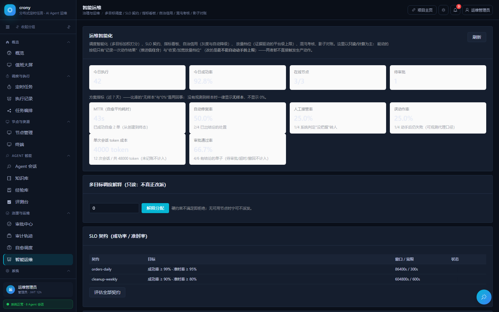
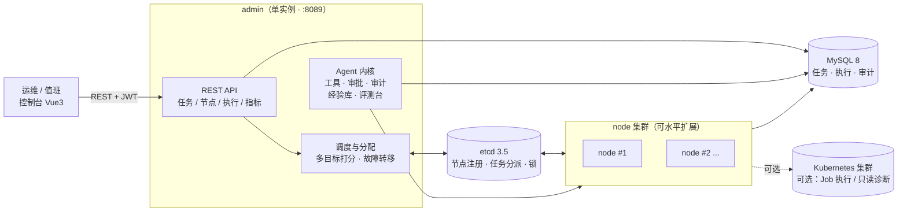

<div align="center">

# crony

**分布式定时任务调度平台 · AI Agent 智能运维控制面**

由 cron / 告警 / 人工 / 上游系统触发 · 由 Agent 决策 · 由受控工具执行 · 由审批、评测与预算兜底


[快速开始](#6-快速开始) · [配置说明](#7-配置说明) · [使用指南](#8-使用指南) · [常见问题](#10-常见问题)

</div>

---

## 目录

- [1. 这是什么](#1-这是什么)
- [2. 功能特性](#2-功能特性)
- [3. 系统架构](#3-系统架构)
- [4. 技术栈](#4-技术栈)
- [5. 目录结构](#5-目录结构)
- [6. 快速开始](#6-快速开始)
- [7. 配置说明](#7-配置说明)
- [8. 使用指南](#8-使用指南)
- [9. 开发与测试](#9-开发与测试)
- [10. 常见问题](#10-常见问题)
- [11. 文档索引](#11-文档索引)
- [12. 许可证与致谢](#12-许可证与致谢)

---

## 1. 这是什么

**crony = 一个分布式定时任务调度底座 + 一层 AI Agent 智能运维控制面。**

| 组成 | 是什么 | 提供者 |
| --- | --- | --- |
| **调度底座** | Go + etcd + MySQL 的分布式定时任务平台：多节点集群、任务自动分配、节点失活故障转移、执行/日志/告警闭环、DAG 多步骤编排 | 基于开源项目 [tmnhs/crony](https://github.com/tmnhs/crony) |
| **智能层** | 让大模型**只读排查故障**、给出建议，并在**人工批准**后执行**白名单写动作**；配套审批、审计、经验库、评测台、放量闸门 | 本项目新增 |

设计目标（三条主线）：

1. **看得见** —— 任务、节点、执行记录、日志、指标大屏，一次跑失败能定位到哪一步、哪台机、哪条命令。
2. **管得住** —— 任何"大模型动手"的动作都必须经过：能力白名单 → 人工审批 → 审计留痕 → 预算上限。
3. **信得过** —— 有黑盒验收用例、评测回放与真实集群集成测试，行为改动可回归、可解释。

> **明确不做**：不做通用 Agent 框架、不做多租户 SaaS、不追求"全自动无人值守"（最高到「建议 + 一键审批」）。

### 界面预览

> 以下截图来自控制台的演示数据（`VITE_USE_MOCK=true`），用于展示页面结构，不代表真实业务数据。

| 概览 | 定时任务 |
| --- | --- |
|  |  |

| 执行记录 | 智能运维 |
| --- | --- |
|  |  |

---

## 2. 功能特性

### 2.1 调度内核（开箱即用）

- **分布式多节点**：admin 单实例管调度与分配，node 可水平扩展；节点注册/心跳/失联判定基于 etcd。
- **任务自动分配**：按节点负载、任务数等多目标打分挑节点；也支持手工指定节点。
- **故障转移**：节点失联后其任务自动重新分配并在其他节点恢复调度。
- **任务类型**：`1` Shell 命令 / `2` HTTP 请求 / `3` Agent 任务 / `4` Kubernetes Job（可选）。
- **调度能力**：秒级 cron、并发策略（允许多实例 / 单实例）、失败重试与退避、执行超时、连续失败告警。
- **DAG 多步骤编排**：一个任务可拆成多个步骤（串行 / 并行 / 依赖 / 失败即停），支持成环校验。
- **执行闭环**：每次执行有 run 记录 + 分步骤日志 + 状态（成功/失败/超时），可查看与清理。
- **通知**：邮件、飞书 Webhook 等渠道。

### 2.2 控制台（Vue 3 + Element Plus，16 个页面）

概览大屏、定时任务、执行记录、编排（DAG）、节点管理、Web 终端、Agent 会话、经验库、记忆库、评测台、审批中心、审计日志、自愈策略、运维视图、系统设置。

### 2.3 AI Agent 智能运维（可选，默认关闭）

- **自然语言建任务**：一句话 → 生成草案（含表达式解析结果、下次触发时间）→ 人工确认后才真正写入。
- **只读诊断工具**：节点状态、日志检索、只读 SQL、只读 shell、HTTP GET、节点探针。
- **写动作需白名单 + 审批**：默认**不注册**任何写工具；开启后也要人工一键批准。
- **自治分级**：L0 只读 → L3 有限自动，默认 L1；每会话有调用次数 / token / 时长预算。
- **自愈 / SLO**：SLO 违约检测、自愈策略（默认关闭）。
- **可审计**：每次工具调用、每次审批都有审计记录，可在控制台检索。

### 2.4 Kubernetes 执行后端（可选，默认关闭）

- 任务在 K8s 里以 Pod 执行（`job_type=4`），带 TTL 自动清理、资源配额、Pod 安全上下文、最小权限 ServiceAccount。
- 额外的只读诊断工具（看 Pod/事件/日志）与写工具（滚动重启，需显式开启）。
- 默认镜像白名单为空 = **拒绝任何镜像**，必须显式配置才可用。

### 2.5 安全默认（默认全关，逐步放宽）

| 开关 | 默认 | 含义 |
| --- | --- | --- |
| `tools.allow-write` | `false` | 不注册任何写动作工具 |
| `tools.allow-destructive` | `false` | 不注册破坏性工具 |
| `k8s.allow-images` | 空 | 不允许任何镜像 |
| `self-heal.enabled` | `false` | 自愈关闭 |
| `auth.allow-public-register` | `false` | 关闭公开注册 |
| 口令 | 无默认值 | 历史上硬编码的 `root/123456` 已移除，不配置就不建账号 |

---

## 3. 系统架构



| 组件 | 职责 | 依赖 |
| --- | --- | --- |
| **admin** | HTTP API、调度与分配、节点协同、AI Agent 内核、托管控制台静态文件 | MySQL、etcd |
| **node** | 执行任务、上报心跳与执行结果 | MySQL、etcd |
| **console** | Web 控制台（编译成静态文件，由 admin 在 `/console/` 提供） | 构建期 Node |
| **MySQL** | 任务定义、执行记录、步骤日志、用户、审计、经验库 | — |
| **etcd** | 节点注册与心跳、任务分派、分布式锁 | — |

> 表结构由 admin/node 启动时**自动迁移**（GORM AutoMigrate），**不需要手工导入 SQL**。

---

## 4. 技术栈

| 层 | 技术 |
| --- | --- |
| 后端 | Go 1.23、Gin、GORM、go-flags、Viper、Zap |
| 存储 / 协调 | MySQL 8（业务数据）、etcd 3.5（服务发现与任务分派） |
| 前端 | Vue 3、Element Plus、Vite 6、Pinia、Tailwind CSS |
| 容器编排 | Kubernetes client-go 0.29（可选执行后端） |
| 大模型接入 | OpenAI 兼容协议（可对接任意兼容服务） |

---

## 5. 目录结构

```
crony/
├── admin/               # admin 服务：HTTP API、调度、节点协同、Agent 内核
│   ├── cmd/             # 程序入口（main）
│   ├── conf/            # 配置文件（testing / production）
│   └── internal/        # handler / service / middleware / model
├── node/                # node 服务：执行任务、上报心跳
├── common/              # 公共库：config / logger / executor / cron 解析 / llm / k8s
├── console/             # 控制台前端（Vue 3 + Vite）
├── acceptance/          # 黑盒验收用例（对真实接口跑）
├── deploy/              # 部署物料（K8s manifests、RBAC 等）
├── doc/                 # 设计文档与截图
├── docker-compose.yml   # 一键启动：mysql + etcd + admin + node
├── Dockerfile           # 多阶段构建：Go 服务端 + 控制台静态文件
├── gate.ps1 / Makefile  # 本地门禁（格式化 / 编译 / 检查 / 单测 / 验收）
└── .env.example         # 环境变量样例
```

---

## 6. 快速开始

### 6.1 前置要求

| 方式 | 需要什么 |
| --- | --- |
| **方式一：Docker Compose（推荐，小白首选）** | Docker 20+ 与 `docker compose` v2。**不需要**本机装 Go / MySQL / etcd / Node |
| **方式二：本地源码运行** | Go 1.23+、MySQL 8、etcd 3.5；要改前端才需要 Node 20+ |

### 6.2 方式一：Docker Compose（三条命令）

**第 1 步：拿到代码并准备配置**

```bash
git clone https://github.com/yty666zsy/crony.git
cd crony
cp .env.example .env          # Windows PowerShell: Copy-Item .env.example .env
```

**第 2 步：编辑 `.env`，改这 4 项**（其余保持默认即可）

```ini
MYSQL_ROOT_PASSWORD=MySQL的root口令
MYSQL_PASSWORD=给crony用户用的口令
CRONY_AUTH_JWT_SECRET=至少32字节的随机串
CRONY_AUTH_BOOTSTRAP_ADMIN_PASSWORD=初始管理员口令（8~20位，只能字母+数字）
```

> ⚠️ 登录口令的校验口径是**纯字母+数字、4~20 位**（登录接口的既有约定）。所以初始管理员口令请用 `Crony2026Admin` 这类组合：写成 `change-me-...` 这种带符号的口令，账号能建出来，但登录会报"request parameter error"。

生成随机密钥：

```bash
openssl rand -hex 32
```

```powershell
# Windows PowerShell
-join ((1..32) | ForEach-Object { '{0:x2}' -f (Get-Random -Maximum 256) })
```

**第 3 步：启动**

```bash
docker compose up -d --build     # 首次要几分钟：编译 Go + 下载依赖 + 构建控制台
docker compose ps                # 等 4 个服务都 healthy/running
```

**打开控制台**：<http://127.0.0.1:8089/console/>

用 `.env` 里的 `CRONY_AUTH_BOOTSTRAP_ADMIN_USER`（默认 `admin`）和第 2 步设置的口令登录。

> 控制台产物已打进镜像（构建时的 `webbuilder` 阶段），**不需要本机 Node 环境**；镜像里那份是连真实后端的构建（`VITE_USE_MOCK=false`），不是演示数据。

常用运维命令：

```bash
docker compose logs -f admin     # 看日志
docker compose restart admin     # 重启 admin
docker compose down              # 停止（保留数据）
docker compose down -v           # 停止并删除数据（清库重来）
```

> 注：Compose 里 MySQL 与 etcd **不对宿主机暴露端口**，只在内部网络互通；admin API/控制台暴露在 `8089`（可用 `.env` 的 `CRONY_ADMIN_PORT` 改）。

### 6.3 方式二：本地源码运行

**第 1 步：起依赖（MySQL 与 etcd）**

```bash
docker run -d --name crony-mysql -p 3306:3306 \
  -e MYSQL_ROOT_PASSWORD=root -e MYSQL_DATABASE=crony \
  mysql:8.0 --character-set-server=utf8mb4 --collation-server=utf8mb4_general_ci

docker run -d --name crony-etcd -p 2379:2379 quay.io/coreos/etcd:v3.5.16 \
  /usr/local/bin/etcd --name=etcd --data-dir=/etcd-data \
  --listen-client-urls=http://0.0.0.0:2379 \
  --advertise-client-urls=http://127.0.0.1:2379
```

也可以直接用本机已装的 MySQL / etcd（只需保证 `3306` / `2379` 可连）。

**第 2 步：用环境变量覆盖配置**（推荐，不用改 `conf/*.json`）

PowerShell：

```powershell
$env:ENVIRONMENT='testing'
$env:CRONY_MYSQL_PATH='127.0.0.1'
$env:CRONY_MYSQL_PORT='3306'
$env:CRONY_MYSQL_USERNAME='root'
$env:CRONY_MYSQL_PASSWORD='root'
$env:CRONY_ETCD_ENDPOINTS='http://127.0.0.1:2379'
$env:CRONY_AUTH_BOOTSTRAP_ADMIN_PASSWORD='CronyAdmin2026'
```

bash：

```bash
export ENVIRONMENT=testing
export CRONY_MYSQL_PATH=127.0.0.1 CRONY_MYSQL_PORT=3306
export CRONY_MYSQL_USERNAME=root CRONY_MYSQL_PASSWORD=root
export CRONY_ETCD_ENDPOINTS=http://127.0.0.1:2379
export CRONY_AUTH_BOOTSTRAP_ADMIN_PASSWORD=CronyAdmin2026
```

**第 3 步：起 admin**（必须**在仓库根目录**执行，否则找不到 `admin/conf`）

```bash
go run ./admin/cmd -e testing
```

**第 4 步：起 node**（另开一个终端，可以起多个模拟多节点）

```bash
go run ./node/cmd -e testing
```

**第 5 步：前端**

- 已有构建产物（`console/dist` 存在）时，admin 会自动在 <http://127.0.0.1:8089/console/> 提供控制台，**无需额外操作**。
- 若要改前端：

```bash
cd console
pnpm install    # 没装 pnpm：npm i -g pnpm（或 corepack enable）
pnpm dev        # 开发服务器 http://localhost:5273/
pnpm build      # 产物落到 console/dist，admin 立即提供，无需重启
```

> `pnpm dev` 默认是 **Mock 数据**（不依赖后端，方便看界面）。要连真后端，在 `console/.env.local` 里写 `VITE_USE_MOCK=false`。

### 6.4 确认跑起来了

```bash
curl http://127.0.0.1:8089/ping         # 通了就说明 admin 活着
```

| 检查项 | 期望 |
| --- | --- |
| `curl http://127.0.0.1:8089/ping` | 有正常响应（不是连接被拒绝） |
| 打开 `/console/` | 出现登录页 |
| 登录后「节点管理」 | 能看到 node 上线（本地方式起 node 后） |
| 「系统设置」 | 能看到配置快照与 `bootstrap_admin` 提示 |

### 6.5 首次登录与账号说明

- 启动时若**用户表为空**且设置了 `CRONY_AUTH_BOOTSTRAP_ADMIN_PASSWORD`（≥ 8 位、非弱口令、**纯字母+数字**），会自动创建管理员（默认用户名 `admin`）。
- 不设置该变量则**不会**创建任何账号，改为允许一次「首个管理员引导注册」：`POST /register`。
- 之后 `auth.allow-public-register` 默认为 `false`，即不再开放注册。
- 旧版本硬编码的默认账号（`root` / `123456`）**已移除**，不会再生效。

---

## 7. 配置说明

### 7.1 配置文件 vs 环境变量

- 配置文件：`admin/conf/<env>/main.json`、`node/conf/<env>/main.json`（`<env>` 由 `-e` / `ENVIRONMENT` 决定，只有 `testing` 与 `production`）。
- 环境变量优先级**高于**配置文件，命名规则：`a.b-c` → `CRONY_A_B_C`（点和横线都换成下划线，加 `CRONY_` 前缀）。
- 例：`auth.jwt-secret` → `CRONY_AUTH_JWT_SECRET`；`mysql.db-name` → `CRONY_MYSQL_DB_NAME`。

### 7.2 常用配置项

| 环境变量 | 说明 | 默认 / 必填 |
| --- | --- | --- |
| `ENVIRONMENT` | 运行环境（`testing` / `production`），也可用启动参数 `-e` | `testing` |
| `CRONY_MYSQL_PATH` / `_PORT` / `_DB_NAME` / `_USERNAME` / `_PASSWORD` | MySQL 连接 | 见 `conf/*.json` |
| `CRONY_ETCD_ENDPOINTS` | etcd 地址，多个用逗号分隔 | `http://127.0.0.1:2379` |
| `CRONY_AUTH_JWT_SECRET` | JWT 签名密钥，≥ 32 字节 | **production 必填**，缺失拒绝启动 |
| `CRONY_AUTH_TOKEN_EXPIRE_HOURS` | 登录令牌有效期（小时） | `168` |
| `CRONY_AUTH_BOOTSTRAP_ADMIN_USER` / `_PASSWORD` / `_EMAIL` | 首个管理员引导账号（口令 8~20 位、纯字母+数字） | 口令未设则不建账号 |
| `CRONY_AUTH_ALLOW_PUBLIC_REGISTER` | 是否允许公开注册 | `false` |
| `CRONY_SYSTEM_ADDR` | admin 监听端口 | `8089` |
| `CRONY_SYSTEM_CMD_AUTO_ALLOCATION` | Shell 任务是否自动分配节点 | `false`（需手工指定） |

### 7.3 开启 AI Agent（可选）

| 环境变量 | 说明 | 默认 |
| --- | --- | --- |
| `CRONY_LLM_ENABLED` | 是否启用大模型能力 | `false` |
| `CRONY_LLM_PROVIDER` / `_BASE_URL` / `_MODEL` | OpenAI 兼容协议的服务地址与模型 | 空 |
| `CRONY_LLM_API_KEY` | 模型密钥（只从环境变量读取） | 空 |
| `CRONY_TOOLS_ALLOW_WRITE` | 是否注册写动作工具 | `false` |
| `CRONY_TOOLS_ALLOW_DESTRUCTIVE` | 是否注册破坏性工具 | `false` |
| `CRONY_TOOLS_AUTONOMY` | 自治等级（`L0` ~ `L3`） | `L1` |
| `CRONY_SELF_HEAL_ENABLED` | 自愈策略 | `false` |

### 7.4 开启 K8s 执行后端（可选）

| 环境变量 | 说明 |
| --- | --- |
| `CRONY_K8S_ENABLED` | 是否启用 K8s 执行后端（`true`） |
| `CRONY_K8S_NAMESPACE` | 任务运行的命名空间 |
| `CRONY_K8S_KUBECONFIG` | kubeconfig 路径（集群内可留空走 ServiceAccount） |
| `CRONY_K8S_ALLOW_IMAGES` | 允许的镜像前缀白名单（空 = 全拒绝） |
| `CRONY_K8S_ALLOW_NAMESPACES` | 允许操作的命名空间 |
| `CRONY_K8S_DEFAULT_CPU` / `_DEFAULT_MEMORY` | 任务默认资源请求 |
| `CRONY_K8S_TTL_SECONDS_AFTER_FINISHED` | 完成后自动清理 Pod 的秒数 |

集群侧 RBAC、示例 Deployment 见 [`deploy/`](deploy/)。

---

## 8. 使用指南

### 8.1 新建任务（cron 表达式必须是 6 段）

标准格式：**`秒 分 时 日 月 周`**（与 Linux 的 5 段 crontab **不同**）。

| 表达式 | 含义 |
| --- | --- |
| `0 0 3 * * *` | **每天 03:00:00** |
| `0 */5 * * * *` | 每 5 分钟 |
| `30 0 9 * * 1-5` | 工作日 09:00:30 |
| `@daily` / `@hourly` / `@every 1h30m` | 描述符写法也支持 |

> ⚠️ 写 5 段（如 `0 3 * * *`）会被**直接拒绝**（错误码 `1002`）。这不是限制你的写法，而是因为内核按「秒 分 时 日 月」解释 5 段，`0 3 * * *` 实际会变成"每小时的第 3 分钟"，静默改写语义比报错危险得多。

### 8.2 任务要「分配给节点」才会执行

- 任务状态只有两种：**未分配（0）/ 已分配（1）**。
- **未分配的任务不会执行**，也不会因为节点上线就自动执行（Shell 任务默认需手工指定节点，见 `cmd-auto-allocation`）。
- 在「定时任务」页编辑任务、选择执行的节点；多节点集群下可用自动分配。

### 8.3 看执行结果

「执行记录」里有每次 run 的状态、耗时、退出码；点进去能看到**分步骤日志**与完整输出。失败/超时（如命令不存在、超时被杀）都记录在此。

### 8.4 多步骤 DAG 编排

一个任务可拆多个步骤，配置步骤依赖、并行度与失败策略（失败即停 / 继续），保存时会做**成环校验**。

### 8.5 用自然语言建任务（需先开启 LLM）

「智能运维 → 新建任务」用一句话描述需求 → Agent 生成草案并解析出触发时间 → **你确认后才写入**。确认页会展示解析后的下次触发时间，避免表达式歧义。

### 8.6 智能运维

- **Agent 会话**：让模型只读排查（看节点、搜日志、只读 SQL）。
- **审批中心**：写动作在执行前需要人工批准，超时自动失效。
- **审计日志**：谁在何时让模型做了什么、调用了哪个工具、参数与结果摘要。
- **经验库 / 记忆库**：沉淀历史故障处置。
- **评测台**：用回放用例评估 Agent 表现。
- **自愈 / SLO**：违约检测与自愈策略（默认关闭）。

---

## 9. 开发与测试

### 9.1 门禁（提交前跑）

```powershell
# Windows
pwsh -File gate.ps1                # 5 步：gofmt / build / vet / vet(tags) / go test
pwsh -File gate.ps1 -Acceptance    # 7 步：再加黑盒验收 + 评测回放（需被测服务已启动）
```

```bash
# Linux / macOS
make gate
```

### 9.2 前端

```bash
cd console
pnpm install
pnpm smoke          # Mock 冒烟（离线可跑，不依赖后端）
pnpm verify:live    # 对着真后端核验接口契约
```

### 9.3 集成测试（可选，需真实集群）

```bash
go test -tags integration ./common/pkg/k8sclient/... -run RealCluster
```

没有集群时相关用例会自动 **Skip**，不会误判为失败。

---

## 10. 常见问题

**Q1：`docker compose up` 报 `请设置 CRONY_AUTH_JWT_SECRET`**
→ 没复制 `.env` 或没填。`cp .env.example .env` 后填入（`openssl rand -hex 32`）。

**Q2：打开 `http://127.0.0.1:8089/` 是 404 / 一行 JSON**
→ 正常。控制台在 **`/console/`**（带结尾斜杠）。根路径 `/` 是旧版前端，默认不构建。

**Q3：控制台里数据是假的（示例任务、示例节点）**
→ 你打开的是 Mock 模式。只用 `pnpm dev`（5273 端口）时默认 Mock；请改用 admin 提供的 `/console/`，或建 `console/.env.local` 写 `VITE_USE_MOCK=false`。

**Q4：登录失败 / 没有账号**
→ 分两种情况：① 库里根本没有账号 —— 设 `CRONY_AUTH_BOOTSTRAP_ADMIN_PASSWORD`（≥ 8 位、非弱口令）后重启 admin，**仅当用户表为空时**才会创建；已建过账号后改这个变量不会改口令。② 返回 `code=1001 request parameter error` —— 口令不符合登录接口的校验（**4~20 位、只能是字母和数字**），换成 `Crony2026Admin` 这类组合。

**Q5：任务建好了但从来不跑**
→ ① 任务是否**已分配节点**（未分配不执行）；② 节点是否在线；③ Shell 任务默认需手工指定节点；④ 看「执行记录」是否有失败/超时。

**Q6：`cron 表达式不合法：只有 5 段`**
→ 本平台要求 6 段：`秒 分 时 日 月 周`，例如 `0 0 3 * * *`。

**Q7：节点起不来 / 报 etcd 相关错误**
→ 先确认 etcd 已启动且 `CRONY_ETCD_ENDPOINTS` 可连。admin 在 etcd 不可用时会**降级启动**（HTTP API 可用，节点协同不可用）并打告警，但 node 必须能连上 etcd。

**Q8：端口被占用（8089 / 3306 / 2379）**
→ 改 `.env` 的 `CRONY_ADMIN_PORT`，或停掉占用进程（`netstat -ano | findstr :8089`）。

**Q9：Windows 上任务执行失败（找不到命令）**
→ 任务里的命令是在**节点所在机器**执行的。Linux 节点写 `sh` 脚本；Windows 节点用 `cmd /c` 或 PowerShell 语法。

**Q10：需要手工导入 SQL 建表吗？**
→ 不需要。admin/node 启动时自动迁移表结构。要清库重来：`docker compose down -v`。

**Q11：Docker 构建报 `failed size validation` / 拉不到基础镜像**
→ 国内网络问题，给 Docker 配镜像加速（Settings → Docker Engine 加 `registry-mirrors`），或换网络重试。

**Q12：日志在哪？**
→ 容器里：`docker compose logs -f admin`，落盘文件在容器内 `admin/logs/`（对应卷 `admin-logs`）；本机方式：`admin/logs/`、`node/logs/`。

**Q13：`docker compose` 首次启动后，`.env` 里的口令怎么登都提示"用户名或密码不正确"**
→ 早期版本在 compose 下会出现：admin 与 node 被同一条命令同时拉起，双方都执行建表，撞上 MySQL `1050 Table already exists` 时 admin 会直接跳过"初始管理员引导"，结果库里**压根没有账号**（报的是口令错误，方向完全被带偏）。本仓库已修：建表遇到并发冲突会自动重试，管理员账号照常创建。核对办法：`docker compose exec mysql mysql -ucrony -p<你的MYSQL_PASSWORD> crony -e "select id,username from crony_user"` —— 如果一行都没有，请更新镜像后 `docker compose down -v && docker compose up -d --build` 重来一遍。

---

## 11. 文档索引

| 文档 | 内容 |
| --- | --- |
| [`doc/`](doc/) | 设计文档与界面截图 |
| [`console/README.md`](console/README.md) | 控制台前端开发说明（环境变量、Mock、构建） |
| [`deploy/k8s/README.md`](deploy/k8s/README.md) | K8s 部署物料与 RBAC 说明 |
| [`acceptance/`](acceptance/) | 黑盒验收用例（对真实接口运行） |
| [`.env.example`](.env.example) / [`docker-compose.yml`](docker-compose.yml) | 部署与配置样例 |

---

## 12. 许可证与致谢

- 本项目采用 **MIT License**，见 [LICENSE](LICENSE)。
- 调度底座基于开源项目 **[tmnhs/crony](https://github.com/tmnhs/crony)**（MIT），在其之上新增了 AI Agent 智能运维控制面、控制台（Vue 3 + Element Plus）与 Kubernetes 执行后端。

<div align="center">
如果这个项目对你有帮助，欢迎 star ⭐
</div>
